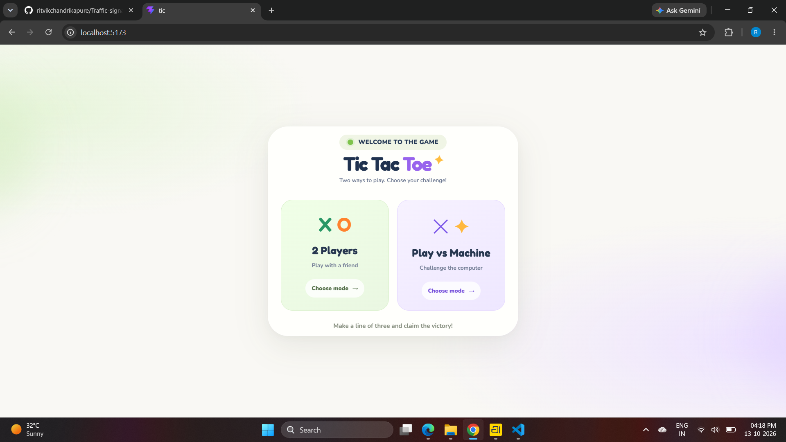
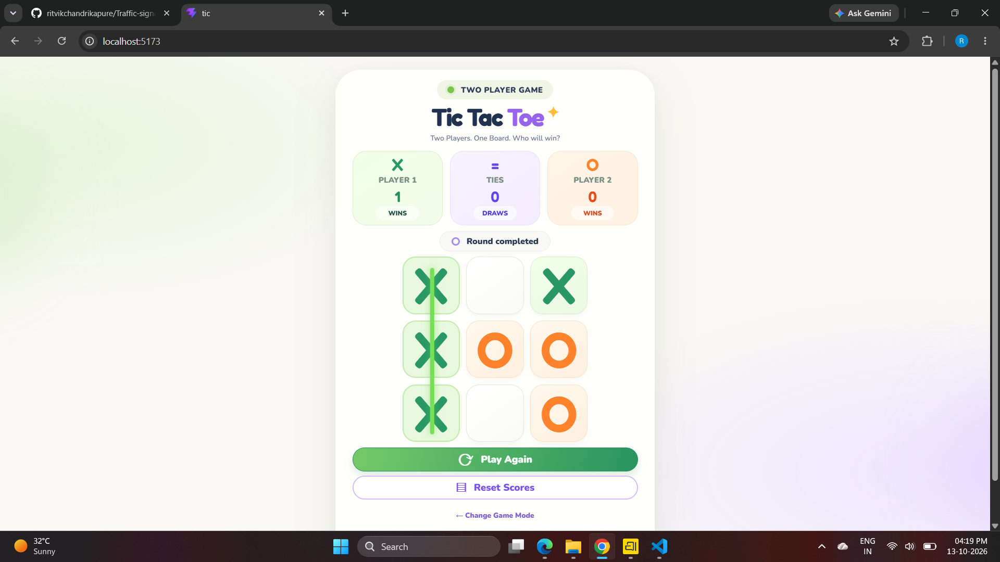
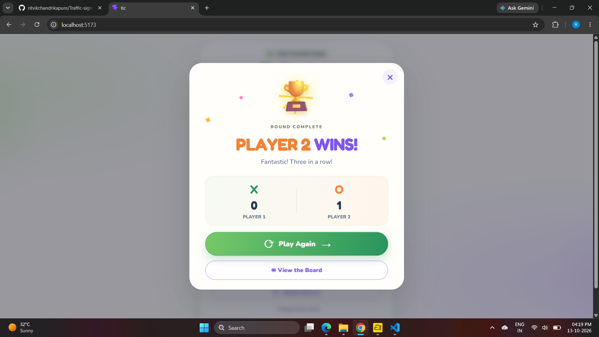

# Tic Tac Toe ✨

A responsive Tic Tac Toe game built with **React**, **Vite**, and **CSS**. Play locally with a friend or challenge the computer, track round results, and start another round whenever you want.

## Screenshots

### 1. Game mode selection


### 2. Two-player game board


### 3. Round winner


## Features

- Two game modes: **2 Players** and **Play vs Machine**.
- Interactive 3 × 3 game board.
- Detects a win when a player gets three marks in a row, column, or diagonal.
- Highlights the winning line.
- Displays the round result.
- Tracks player wins and draws.
- Play Again and Reset Scores controls.
- Option to return to the game mode selection screen.

## Tech Stack

- React
- Vite
- JavaScript / JSX
- CSS

## Run Locally

1. Open a terminal in the project folder.
2. Install dependencies:

   ```bash
   npm install
   ```

3. Start the development server:

   ```bash
   npm run dev
   ```

4. Open the local URL shown in the terminal, usually `http://localhost:5173`.

## Project Structure

```text
tic/
├── src/
│   ├── images/
│   │   ├── tic1.png
│   │   ├── tic2.png
│   │   └── tic3.png
│   ├── App.jsx
│   ├── App.css
│   ├── index.css
│   └── main.jsx
├── public/
├── index.html
├── package.json
└── vite.config.js
```

## Screenshots on GitHub

Keep the image files in `src/images/` and preserve their exact filenames. The screenshot links above are relative to the repository root, so GitHub can render them in this README.

---
Built with React and Vite.
